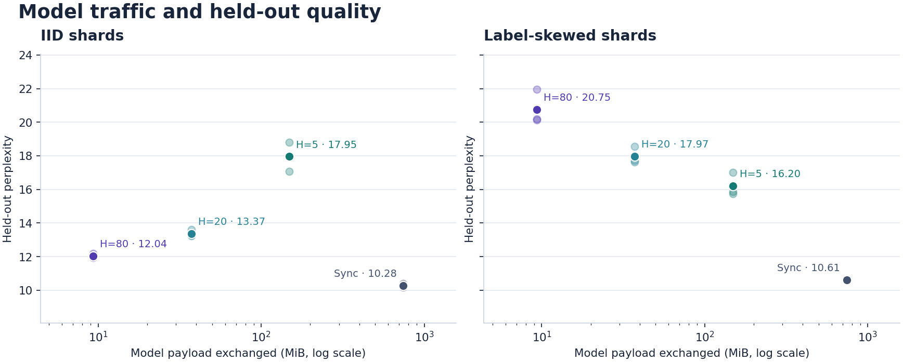

# DiLoCo Communication Benchmark

How much communication can local training save, and what does it cost in model quality? This benchmark compares DiLoCo with synchronous data-parallel AdamW on next-character prediction. It runs four CPU worker processes and counts the model payload each worker actually exchanges with the coordinator.

**80× fewer model bytes on IID data** at 80 local steps per synchronization. Total payload fell from **745.04 MiB to 9.31 MiB**. Held-out top-1 accuracy fell from **34.44% to 32.74%**, and perplexity rose from **10.28 to 12.04**. When each worker saw a different set of target labels, the same schedule raised perplexity from **10.61 to 20.75**.



## Results

Each row reports the endpoint after 320 minibatches per worker. Perplexity and accuracy are arithmetic means across seeds 0, 1, and 2. Within each seed and sharding regime, all methods use the same parameter initialization, worker shards, and minibatch streams.

| Worker data | Method | Local steps per sync | Exchanges per worker | Model payload | Held-out perplexity ↓ | Top-1 accuracy ↑ |
| --- | --- | ---: | ---: | ---: | ---: | ---: |
| IID | Synchronous AdamW | 1 | 320 | 745.04 MiB | 10.28 | 34.44% |
| IID | DiLoCo | 5 | 64 | 149.01 MiB | 17.95 | 31.50% |
| IID | DiLoCo | 20 | 16 | 37.25 MiB | 13.37 | 32.71% |
| IID | DiLoCo | 80 | 4 | 9.31 MiB | 12.04 | 32.74% |
| Label-partitioned | Synchronous AdamW | 1 | 320 | 745.04 MiB | 10.61 | 33.74% |
| Label-partitioned | DiLoCo | 5 | 64 | 149.01 MiB | 16.20 | 29.87% |
| Label-partitioned | DiLoCo | 20 | 16 | 37.25 MiB | 17.97 | 28.93% |
| Label-partitioned | DiLoCo | 80 | 4 | 9.31 MiB | 20.75 | 26.39% |

For IID workers, perplexity at 80 local steps ranged from 11.94 to 12.18 across the three seeds, versus 10.18 to 10.40 for synchronous AdamW. Increasing the interval improved the DiLoCo endpoint within this IID sweep and worsened it under label partitioning. The schedule also changes the number of outer updates and AdamW state resets. Each run uses the same configured optimizer settings, so the results describe this sweep.

[Endpoint metrics](results/summary.csv) · [Learning curves](results/convergence.png) · [Checkpoint metrics](results/learning_curves.csv) · [Shard composition](results/shards.csv) · [Run configuration](results/config.json)

## Method

- **Workload.** A 38,146-parameter NumPy MLP takes eight characters and predicts the next one. Tiny Shakespeare is split chronologically before making windows or fitting the vocabulary. The training pool uses 65,536 evenly spaced windows from the training region and evaluation uses 4,096 from the held-out region.
- **Synchronous baseline.** Workers calculate gradients from the shared weights on each step. The coordinator averages gradients and takes one AdamW step.
- **DiLoCo.** Each worker runs local AdamW from the latest shared weights. Once per round, the coordinator subtracts the mean of the returned parameters from the shared weights and applies an outer Nesterov update. Workers start each round with fresh inner optimizer state. The coordinator carries momentum across rounds. [DiLoCo paper](https://arxiv.org/abs/2311.08105)
- **Communication.** Four local OS processes exchange raw float64 weights or gradients with the coordinator through duplex pipes. One exchange sends and receives a full 305,168-byte parameter-sized vector per worker. Counters cover the serialized model payload. They exclude initialization, evaluation, control messages and IPC framing. The experiment measures payload and held-out quality on one host. WAN latency, throughput and language-model scaling are outside its scope.
- **Data regimes.** The IID condition randomly partitions windows. The label-partitioned condition assigns each next-character class to one worker, producing a deliberately strong skew with disjoint target class sets. It tests sensitivity to one specific form of non-IID data.

## Reproduce

The package supports Python 3.10 and newer. Use Python 3.11 or newer for the pinned NumPy version below. Published results used Python 3.12.14 and NumPy 2.3.5 on Linux x86-64.

```bash
python -m pip install ".[charts]" "numpy==2.3.5"

curl -fL https://raw.githubusercontent.com/karpathy/char-rnn/6f9487a6fe5b420b7ca9afb0d7c078e37c1d1b4e/data/tinyshakespeare/input.txt -o tinyshakespeare.txt

OPENBLAS_NUM_THREADS=1 OMP_NUM_THREADS=1 \
  diloco-benchmark --corpus tinyshakespeare.txt --output reproduced

python scripts/plot_results.py reproduced
```

The corpus SHA-256 is `86c4e6aa9db7c042ec79f339dcb96d42b0075e16b8fc2e86bf0ca57e2dc565ed`. The default grid runs both sharding regimes with three seeds and four synchronization schedules. Use `diloco-benchmark --help` to see the available controls. [Pinned corpus source](https://github.com/karpathy/char-rnn/tree/6f9487a6fe5b420b7ca9afb0d7c078e37c1d1b4e/data/tinyshakespeare)

## Code and validation

| Path | Role |
| --- | --- |
| [`diloco/distributed.py`](diloco/distributed.py) | Worker process lifecycle, synchronous and DiLoCo coordination, payload accounting |
| [`diloco/workload.py`](diloco/workload.py) | Chronological corpus split, character windows, worker data partitions |
| [`diloco/network.py`](diloco/network.py) and [`diloco/optim.py`](diloco/optim.py) | Manual backpropagation, stable cross-entropy, AdamW and Nesterov |
| [`model.py`](model.py) and [`scaffold.py`](scaffold.py) | Original 30-function entry point and synthetic demo |
| [`tests/`](tests/) | Finite-difference gradient check, optimizer and sharding checks, process and payload integration test |

```bash
OPENBLAS_NUM_THREADS=1 OMP_NUM_THREADS=1 python -m unittest discover -s tests -v
python scaffold.py
```
